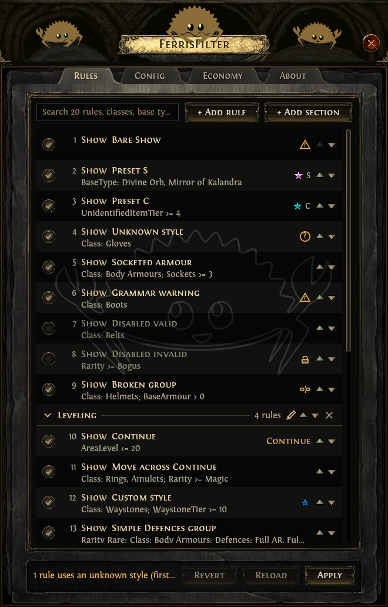
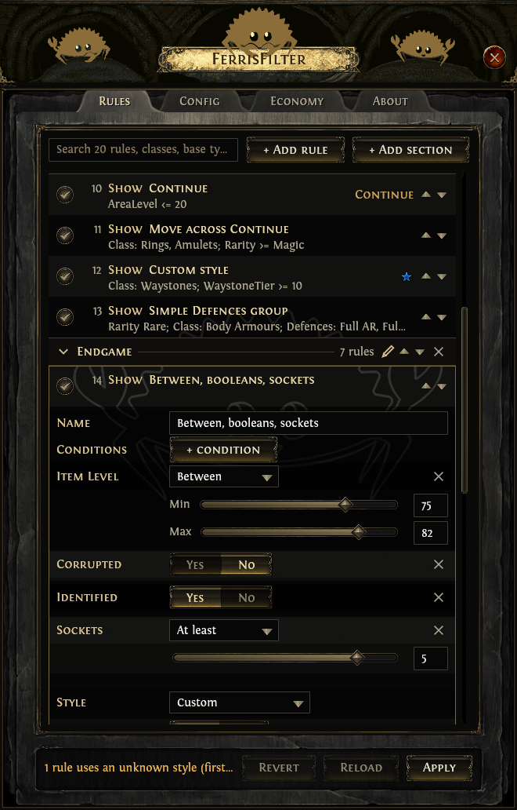
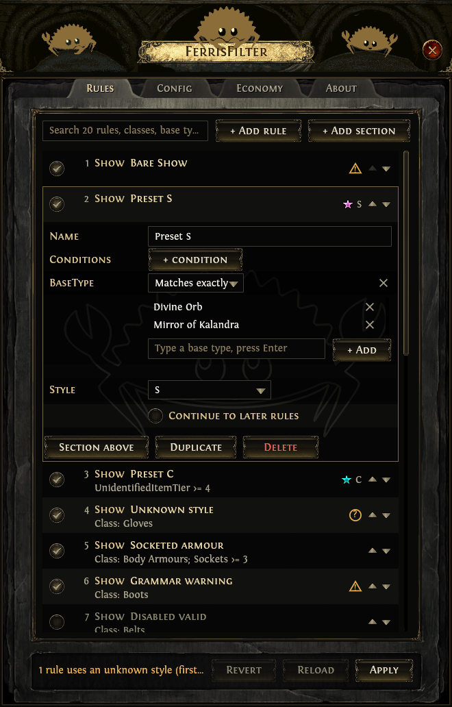
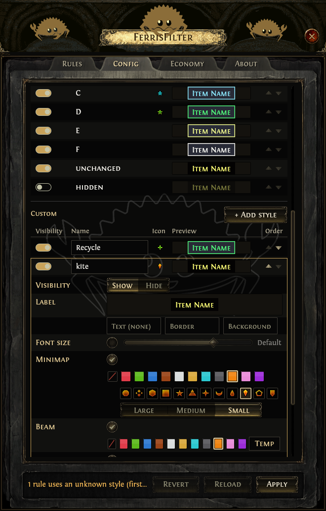
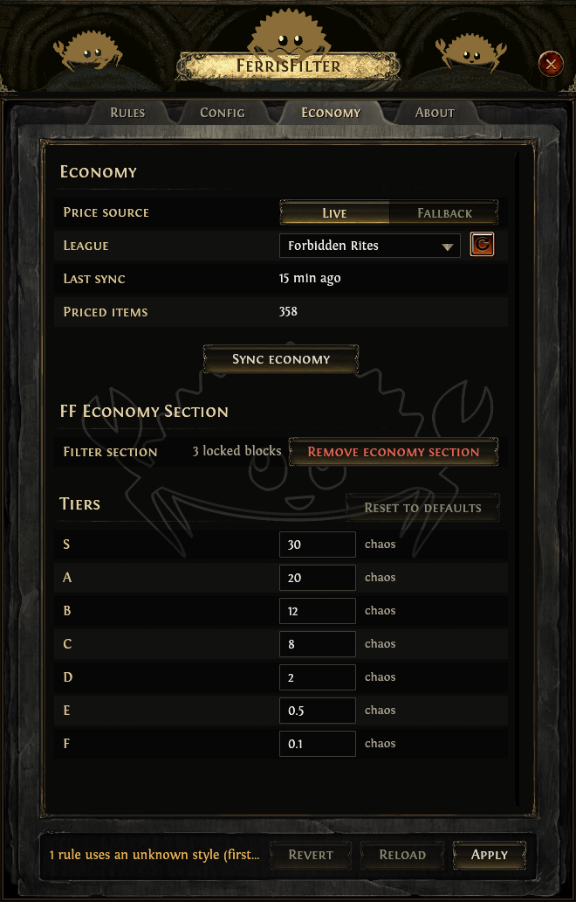
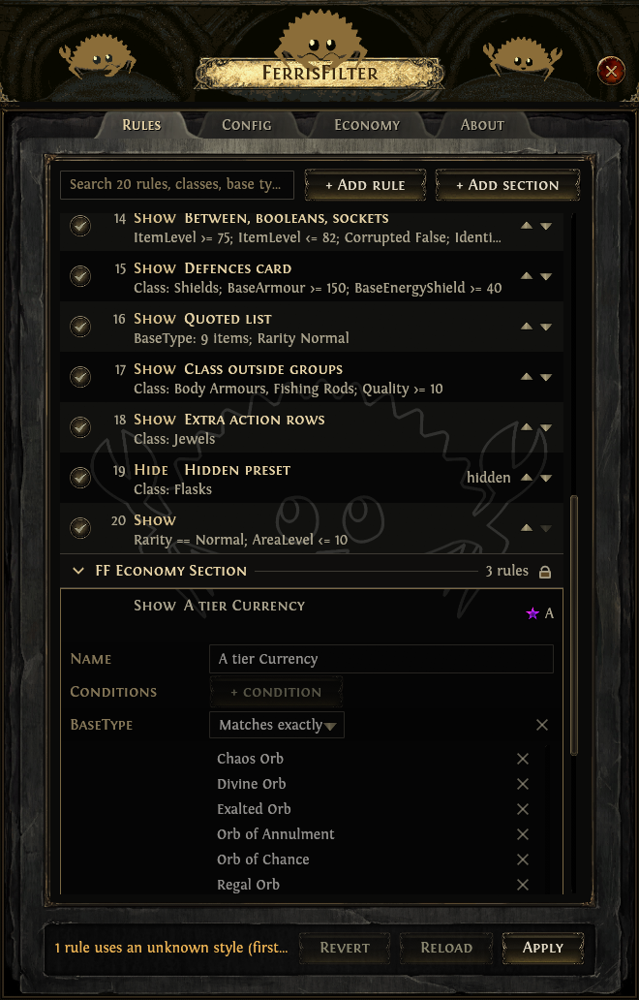

# FerrisFilter

FerrisFilter (FF) is an overlay for Path of Exile 2 that allows you to
easily modify local loot filters and economy sync for your trade
league. You can either use it to create a full loot filter for your
usage or alter just a few rules on an already large preset loot filter.

<table>
  <tr>
    <td align="center"></td>
    <td align="center"></td>
  </tr>
  <tr>
    <td align="center">General rule view</td>
    <td align="center">Rule editing</td>
  </tr>
  <tr>
    <td align="center"></td>
    <td align="center"></td>
  </tr>
  <tr>
    <td align="center">Styles on rules</td>
    <td align="center">Shared style support</td>
  </tr>
  <tr>
    <td align="center"></td>
    <td align="center"></td>
  </tr>
  <tr>
    <td align="center">Economy sync</td>
    <td align="center">Generated economy rules</td>
  </tr>
</table>

## What it does

The window is docked to the left edge of the screen, just like the
game settings, and has four tabs.

- **Rules**: General rules view and browsing, and rule editing. Rules
  can be added, deleted, duplicated, reordered, enabled, disabled, or
  styled. Rules can be grouped into collapsible sections, so you can
  stack rules you don't wanna touch and focus on the rules that you
  do. The FF economy section is locked, sits last, and is managed by
  the tool itself.
- **Config**: picks which filter file you will be using and holds the
  named styles: colors, font size, minimap icon, beam and sounds,
  easily reused in as many rule blocks as you want later on.
- **Economy**: syncs prices from poe.ninja, adds or removes the
  economy section and edits the tier cutoffs.
- **About**: shows the version, credits and the disclaimer.

Edits stay in memory until **Apply**, which writes the styles, tiers
and filter together and, if the game is running, sends
`/reloaditemfilter` to it. **Revert** and **Reload** undo pending
changes.

## Using it

- Run Path of Exile 2 in windowed or windowed-fullscreen mode; the
  overlay cannot draw over exclusive fullscreen.
- `Ctrl+Shift+Z` shows or hides the window, only while the game or the
  overlay is the foreground window. The close button only hides it;
  **Quit** in the system tray icon exits.

Your settings live in `%APPDATA%\FerrisFilter` (created on the first
save): `styles.json`, `tiers.json`, `prices.json` and
`ff-settings.json`.

## Building

```bash
cargo build --release
```

This produces `target/release/ff.exe`. `rust-toolchain.toml` selects
the nightly channel.

You can also get the pre-compiled binaries from the [release
tab](https://github.com/Jonathas-Conceicao/ferris-filter/releases).

## References

- [pathofexile.com](https://www.pathofexile.com/item-filter/about):
  Filter grammar.
- [poe.ninja](https://poe.ninja/poe2/economy): Economy prices and
  league info.
- [poe2db](https://poe2db.tw/us/): Item names and values.
- [poe2filter.com](https://poe2filter.com/): Some of the usage
  inspiration and the tool I used before this one.
- [FilterBlade](https://www.filterblade.xyz/?game=Poe2): Some more
  inspiration as the most popular PoE Filter tool.
- [Dracula](https://draculatheme.com/): The high-contrast colour
  scheme behind the default styles, a personal favourite of mine.

## AI Disclaimer

This tool was built with the help of [Claude AI](https://claude.ai/).
I'm an experienced Software Developer, but AI allows me to develop
stuff for myself and the community while I game :). Claude assisted
with writing the implementation, but logic, UX and testing are handled
by me. The tool is maintained by me to the best of my abilities, use
at your own risk.

The custom icons/art are not done by AI, I enjoy making barely
acceptable art and silly edits :)

## Credits and disclaimer

FerrisFilter is a third-party tool made for Path of Exile 2
players. This product isn't affiliated with or endorsed by Grinding
Gear Games in any way.

- The UI art in `assets/poe2/` is extracted from Path of Exile 2 and
  belongs to Grinding Gear Games. It is used for a non-commercial fan
  tool and will be replaced if GGG objects.
- The Fontin fonts (`assets/poe2/fonts/`) are by exljbris (Jos
  Buivenga) and ship with Path of Exile 2.
- Ferris (the cool crab used all around) is the unofficial community
  Rust (Programming Language used for this tool) mascot by Karen Rustad
  Tölva, released to the public domain
  ([rustacean.net](https://rustacean.net/)).

## License

The FerrisFilter source code is licensed under GPL-3.0-or-later (see
`LICENSE`), and so is my custom art in `assets/custom/`. Everything
else in `assets/` keeps its own owner and terms, listed in
`assets/README.md`.
