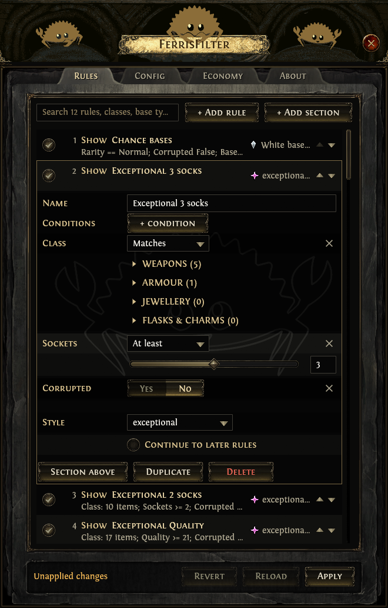
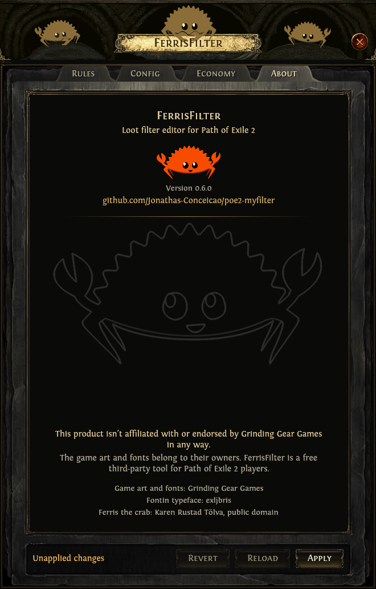

# FerrisFilter

FerrisFilter is a Rust tool for Path of Exile 2 loot filters. It compiles a human-editable
config into a filter, fetches item prices from poe.ninja, and ships an in-game overlay (`ff`)
that edits a filter file in place.

## The overlay (`ff`)


`cargo build` produces `ff`, a game-styled window docked to the left edge of the screen. It has
four tabs.

- **Rules** lists the rules of the filter in the game folder (`dynamic.filter` by default). Rules
  can be added, deleted, duplicated, reordered, enabled or disabled, named and given a style.
  Collapsible sections are written to the file as `# ff:section` banners. The economy section is
  locked, sits last under its `# ff:economy-begin` banner, and is regenerated on Apply. Clicking a
  rule opens its editor (conditions, style, actions).

  

  

- **Config** picks which filter file the Rules tab edits and holds the named styles
  (`styles.json`): colours, font size, minimap icon, beam and sounds.

  

- **Economy** syncs prices from poe.ninja, adds or removes the economy section and edits the tier
  cutoffs (`tiers.json`).

  

- **About** shows the version, credits and the disclaimer.

  

Edits stay in memory until **Apply**, which writes the styles, tiers and filter together and, if
the game is running, sends `/reloaditemfilter` to it. **Revert** and **Reload** undo edits.

- Run Path of Exile 2 in windowed or windowed-fullscreen mode; the overlay cannot draw over
  exclusive fullscreen.
- `Ctrl+Shift+Z` shows or hides the window, only while the game or the overlay is the foreground
  window. The close button only hides it; **Quit** in the system tray icon exits.
- Only one `ff` runs at a time; starting it again brings up the running window.

## Command line

`ff-cli` and `ferrisfilter` are the same console program.

- `generate` compiles `config.json` with `styles.json` and `tiers.json` into `universal.filter`.
- `sync [--league <name|slug>]` writes `prices.json` from poe.ninja.
- `install [--dest <dir>] [--input <file>]` copies `universal.filter` into the game folder
  (`%USERPROFILE%\OneDrive\Documentos\My Games\Path of Exile 2` by default).
- `apply [--filter <path>] [--add-economy | --remove-economy]` refreshes the economy section of a
  filter file. Without a flag it only refreshes an existing section.

## Files

- `config.json`: the rules `generate` compiles (first match wins).
- `styles.json`, `tiers.json`: your live styles and tier cutoffs. Git-ignored; when absent,
  `styles-default.json` and `tiers-default.json` are used.
- `prices.json`: synced prices. Git-ignored. `prices-fallback.json` and `tiers-fallback.json` are
  used when it is missing or with `--early-game`.
- `dynamic.filter`: the filter the overlay edits, in the game folder.
- `ff-settings.json`: overlay settings (chosen filter, collapsed sections, reload after Apply).
- `CLAUDE.md`: the filter syntax reference and repo conventions.

## Building

```bash
cargo build
cargo test
```

`rust-toolchain.toml` selects the nightly channel. The repo is a Cargo workspace (`ff` and
`tools/ff-art`).

## References
- Filter syntax: <https://www.pathofexile.com/item-filter/about>
- Exact item names / values: <https://poe2db.tw/us/>

## Game art tool (`ff-art`)
`tools/ff-art/` extracts the UI art listed in `assets/poe2/manifest.toml` from the game install
into `assets/poe2/` (PNGs and the Fontin fonts) and renders the Ferris background
(`assets/ui/ferris-bg.png`). It reads the install **read-only**. It is a member of the repo's Cargo workspace but not a default
member, so `cargo build`/`cargo test` at the root never build it or its dependencies. It uses the
`poe_data_tools` library, which needs nightly: `rust-toolchain.toml` selects the nightly channel
(not a specific compiler; set a dated nightly there if a new one breaks `poe_data_tools`). Re-run it after a
game patch:

```bash
cargo ff-art                                         # extract everything in the manifest
cargo ff-art --game "D:\Games\Path of Exile 2"   # non-default install folder
cargo ff-art list optionsmenu              # find virtual paths
cargo ff-art dump "uiimages/common/" <scratch-dir>   # convert matches to PNG to look at
cargo ff-art dump minimap/player <scratch-dir>      # the whole minimap icon sheet
cargo ff-art ferris                        # only re-render the Ferris background
```

It runs from any folder in the repo (the alias in `.cargo/config.toml` is
`cargo run -p ff-art --release --`), and outputs always land in the repo's `assets/` (override with
`--root`).

The default install folder is `C:\Program Files (x86)\Steam\steamapps\common\Path of Exile 2`.
`sheet`, `info` and `zoom` help inspect candidates and screenshots (see `--help`).

## Credits and disclaimer
FerrisFilter is a third-party tool made for Path of Exile 2 players. This product isn't affiliated with or endorsed by Grinding Gear Games in any way.

- The UI art in `assets/poe2/` is extracted from Path of Exile 2 and belongs to Grinding Gear
  Games. It is used for a non-commercial fan tool and will be replaced if GGG objects.
- The Fontin fonts (`assets/poe2/fonts/`) are by exljbris (Jos Buivenga) and ship with Path of
  Exile 2.
- Ferris (`assets/ferris/` and the derived `assets/ui/ferris-bg.png`) is the unofficial community
  Rust mascot by Karen Rustad Tölva, released to the public domain
  ([rustacean.net](https://rustacean.net/)).
